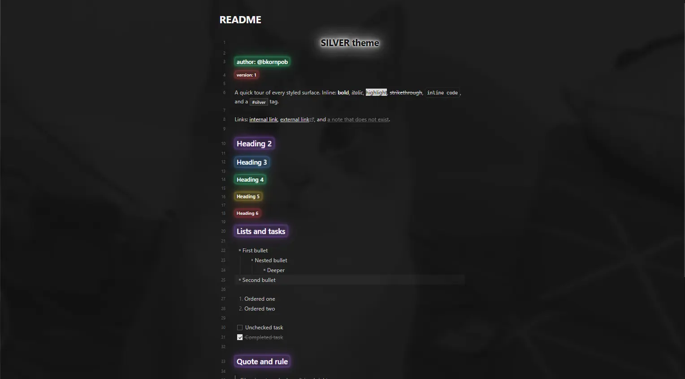

# SILVER

> Silver is not a color here. It is a brightness.

  

**SILVER** is a dark, monochrome theme for [Obsidian](https://obsidian.md/). Graphite surfaces, silver hairlines, bright-silver interaction points, and square corners everywhere. Emphasis comes from brightness, weight and 1px rules, like an instrument panel. The one exception is the heading plates, which glow in neon.

Author: [@bkornpob](https://github.com/bkornpob) · Version: 0.1.0 · License: MIT

## Features

- Graphite and silver palette for the whole interface, with no color in the UI chrome
- Square corners and 1px rules throughout
- Neon heading plates: a centered, glowing H1 and colored glow plates for H2-H6, in both reading view and live preview
- Optional background photo with translucent sidebars and editor panel, all adjustable with CSS variables
- Styled callouts, tables, code blocks, tags, checkboxes, highlights and links

## Installation

**From the Obsidian community directory** (once listed)

1. Open **Settings → Appearance**.
2. Under **Themes**, choose **Manage** and search for **SILVER**.
3. Select **Install and use**.

**Manually**

1. Create the folder `<your vault>/.obsidian/themes/SILVER/`.
2. Copy `theme.css` and `manifest.json` into it.
3. Reload Obsidian, then pick **SILVER** under **Settings → Appearance → Themes**.

> **Dark mode only.** SILVER styles `.theme-dark` only. Set Obsidian to dark under **Settings → Appearance → Base color scheme**.

## Customizing the background

At the top of `theme.css`, a few variables control the background photo and panels:

| Variable               | What it does                                           |
| ---------------------- | ------------------------------------------------------ |
| `--silver-bg-blur`     | `0px` is a sharp photo; try `4px` to `24px`            |
| `--silver-bg-dim`      | Brightness: `0` is black, `1` is the original          |
| `--silver-bg-saturate` | `0` is grayscale, `1` is full color                    |
| `--silver-bg-size`     | `cover`, `contain`, `auto`, or a value like `120%`     |
| `--silver-bg-position` | `center`, `top`, `bottom`, or a value like `50% 30%`   |
| `--silver-panel-alpha` | Sidebar and chrome opacity: `0` is glass, `1` is solid |
| `--silver-main-alpha`  | Main editor panel opacity                              |

## Credits

The neon heading style is adapted from the _Cyber Glow_ theme.

## Support and feedback

Found a bug or have an idea? Please [open an issue](https://github.com/bkornpob).

---

## In memory of SILVER

_2016 - November 16, 2026_

_My cat, my companion, my home._

SILVER was my companion for ten years. He passed away just a few days ago.

I made this theme as part of my healing. Every square corner and every quiet silver line is something I built while missing him. Naming it after him was the only thing that felt right.

**If you are grieving too**, whether it's a pet, a person, or something else you've lost, I hope this helps a little:

- You don't have to be okay, and you don't have to hurry.
- Making something small with your hands or your code can give your grief somewhere to go. It doesn't need to be good or shared, it just needs to be yours.
- Say their name. Tell their stories. Keep something of them close.
- Reach out to someone who understands. Many people have loved a pet like family, and you're not alone in it.

If SILVER helps you write, think, or remember, then he's still keeping someone company.

### A few songs for him

I put together a small playlist as a tribute. 🤍

[▶️ **Watch the SILVER playlist on YouTube**](https://www.youtube.com/playlist?list=PLRbxKENZ4wQY)
